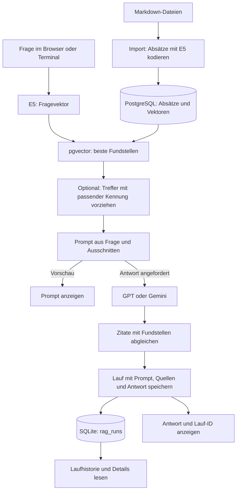

# Cosi-Lab – Lernversion

Cosi-Lab ist ein Python-Lernprojekt mit zwei Anwendungen. Die **Temperaturauswertung** zählt im Terminal Messwerte aus CSV-Dateien und kann daraus einen Modellbericht erstellen. Die **Dokusuche** beantwortet im Browser oder Terminal Fragen zu lokalen Markdown-Dateien mit E5, PostgreSQL und wahlweise GPT oder Gemini. Beide Anwendungen speichern Modellläufe lokal in SQLite.

**Stand: 28.11.2026 · Branch `rag-e5-neustart`.** Die [Browseranleitung](#dokusuche-im-browser) führt von der Vorschau bis zum gespeicherten Lauf. Die [Kennungsoption](#treffer-mit-gleicher-kennung-vorziehen) lässt sich im [Praxisbestand zur Pumpenwartung](#praxisbestand-zur-pumpenwartung) ausprobieren. Das [Lernjournal vom 19.11.2026](docs/journal/2026-11-19.md) erklärt den Neustart der Dokusuche und den Arbeitsordner auf Mac und Cosi-Lab.

## Datenfluss

Die Dokusuche nutzt **RAG** (*Retrieval-Augmented Generation*): Erst werden passende Dokumentabsätze gesucht, dann kann ein Antwortmodell daraus eine belegte Antwort formulieren. Der Dokumentimport und das Stellen einer Frage sind getrennte Abläufe.



`rag_api.py` liefert die Browseroberfläche aus; `rag_cli.py` bietet den Terminalzugang. Beide nutzen dieselbe Suche (`rag_suche.py`), dieselbe Promptvorlage (`rag_prompt.py`) und denselben Ablauf für Modellaufruf, Zitatprüfung und Speicherung (`rag_ablauf.py`).

Die **Temperaturauswertung** nimmt einen anderen Weg: CSV → Kennzahlen → optionaler GPT- oder Gemini-Bericht → SQLite-Tabelle `model_runs`. Der Bericht lässt sich anschließend als Textdatei exportieren. Die Temperaturauswertung braucht kein PostgreSQL.

| Speicher | Aufgabe | Was nach einer Änderung passiert |
| --- | --- | --- |
| `examples/rag/`, `examples/rag-praxis/` | Markdown-Originale für den Beispiel- und den Praxisbestand. | `RAG_BESTAND` wählt beim Import Ordner und Datenbank gemeinsam. |
| PostgreSQL, `public.rag_abschnitte` | Absatztext, relativer Dateipfad, Zeilenbereich und E5-Vektor in der Datenbank des gewählten Bestands. | Ein Neuimport ersetzt die Absätze nur in dieser Datenbank. |
| SQLite, `data/model_runs.sqlite3` | Laufhistorie: `model_runs` für Temperaturberichte und `rag_runs` für Dokufragen. | Ein Neuimport nach PostgreSQL ändert keine alten Läufe. Sie enthalten ihre damaligen Ausschnitte als eigene Kopie. |

## Schnellstart

Alle Befehle laufen im Projektordner. Als Python-Version ist **3.14** vorgesehen: Die hier dokumentierten Live-Läufe der RAG-CLI wurden auf dem Mac mit Python 3.14.6 geprüft, das Temperatur-Image verwendet Python 3.14.

```bash
python3 -m venv .venv
```

Verwende danach `.venv/bin/python`. Für das reine Zählen von Temperaturwerten und das Lesen vorhandener SQLite-Läufe im Terminal genügt die Python-Standardbibliothek. Für die Dokusuche einschließlich Browseroberfläche installierst du:

```bash
.venv/bin/python -m pip install -r requirements.txt -r requirements-rag.txt -r requirements-api.txt
```

`requirements.txt` enthält die Pakete für die Modellanbieter und die `.env`-Datei. `requirements-rag.txt` bringt E5 und die PostgreSQL-Anbindung mit, `requirements-api.txt` die Web-API und Uvicorn. Für PostgreSQL brauchst du Docker mit Compose auf dem Rechner, auf dem die Dokusuche läuft.

Lege die benötigten Werte in der lokalen `.env` im Projektordner ab. Die Beispielwerte ersetzt du durch deine eigenen Werte:

```dotenv
# Für PostgreSQL und die lokale Dokusuche:
RAG_POSTGRES_PASSWORD=hier_eigenes_passwort_eintragen

# Nur für Aufrufe des jeweiligen Anbieters:
# OPENAI_API_KEY=hier_eigenen_schluessel_eintragen
# GEMINI_API_KEY=hier_eigenen_schluessel_eintragen
```

Für eine Modellantwort entfernst du das führende `#` bei der Zeile des gewählten Anbieters und trägst dessen Schlüssel ein. Die Vorschau benötigt E5 und PostgreSQL. Wenn das E5-Modell noch nicht im lokalen Cache liegt, lädt Sentence Transformers es beim ersten Bedarf herunter. Danach verwendet der laufende Python-Prozess dasselbe Modell weiter. Die `.env` wird von Git ignoriert.

## Temperaturdaten auswerten

```bash
.venv/bin/python temperature_cli.py examples/temperature_sample.csv
.venv/bin/python temperature_cli.py examples/temperature_sample.csv \
  --threshold 65 --show-temperatures --show-prompt
```

Die CSV muss eine Spalte `temperature_c` enthalten. Leere Felder gelten als fehlende Werte. Das Beispiel enthält vier Einträge: drei gültige Messwerte und einen fehlenden. Bei der Standardschwelle von 60 °C liegt genau ein Wert darüber; bei 65 °C keiner, weil Gleichheit nicht als Überschreitung zählt. `--show-temperatures` zeigt die eingelesene Liste, `--show-prompt` den Schreibauftrag mit den berechneten Kennzahlen.

### Modellbericht schreiben und wieder öffnen

```bash
.venv/bin/python temperature_cli.py examples/temperature_sample.csv --gpt
.venv/bin/python temperature_cli.py examples/temperature_sample.csv --gemini
```

Pro Aufruf ist höchstens ein Anbieter erlaubt. Beide Anbieter bekommen denselben aus den Kennzahlen gebauten Prompt. Ein gespeicherter Lauf erhält eine ID in `model_runs` und enthält CSV-Pfad, Schwelle, Modell, Prompt, Antwort, Zeitstempel und die verfügbaren Token- und Laufzeitwerte.

```bash
.venv/bin/python show_temperature_run.py 1
.venv/bin/python show_temperature_run.py 1 --export
```

Setze statt `1` die ausgegebene **Temperatur-Lauf-ID** ein. Die Ansicht liest SQLite schreibgeschützt. Mit `--database PFAD` kannst du eine andere Datei angeben. Beim Export siehst du den Zielpfad und die Vorschau; erst nach `ja` wird beispielsweise `reports/model-run-1.txt` geschrieben. Ein vorhandener Bericht bleibt erhalten. Details stehen in der [Exportanleitung](docs/anleitung-berichtsexport.md).

### Temperaturauswertung in Docker

```bash
mkdir -p data reports
COSI_UID="$(id -u)" COSI_GID="$(id -g)" docker compose run --rm --build temperature
```

Der Standardbefehl im Container wertet `examples/temperature_sample.csv` aus. `data/` und `reports/` sind Verzeichnisse des Host-Rechners; dort bleiben Laufdaten und Exporte nach dem Containerlauf erhalten. `COSI_UID` und `COSI_GID` geben dem Container die Kennungen deines lokalen Benutzers, damit er in diese Verzeichnisse schreiben kann. Der Dienst ist in [compose.yaml](compose.yaml) definiert.

## Dokusuche mit E5 und PostgreSQL

### Datenbank starten und Dokumente importieren

Starte auf dem Mac bei Bedarf zuerst Docker Desktop. Auf Cosi-Lab kannst du `sudo docker …` verwenden, falls dein Benutzer Docker nicht direkt ausführen darf. Importiere die Dokumente beim ersten Start und nach Änderungen an den Beispieldateien. Bei einem gewöhnlichen Neustart bleibt der Suchbestand im Docker-Volume erhalten.

```bash
docker compose -f compose.rag.yaml up -d --wait
.venv/bin/python rag_import.py
```

[compose.rag.yaml](compose.rag.yaml) startet PostgreSQL 17 mit pgvector als Dienst `rag-db`. Die Anwendung verbindet sich auf demselben Rechner mit `127.0.0.1:5433` und der Rolle `cosi_rag`. Das lokale Passwort stammt aus `RAG_POSTGRES_PASSWORD`. Ohne `RAG_BESTAND` verwendet sie den Beispielbestand in `cosi_rag`.

Im Standardbestand liest der Import die Markdown-Dateien direkt in [examples/rag/](examples/rag/). Leerzeilen trennen die Absätze; Hauptüberschriften mit `# ` werden nicht als eigener Inhalt gespeichert. E5 kodiert die Absätze mit dem Präfix `passage:`. Die drei Beispieldateien ergeben **zwölf Absätze mit je 384 Vektorwerten**. Die README und die Hardware- und Fernzugriffsdoku gehören zu keinem der beiden Suchbestände.

```bash
docker compose -f compose.rag.yaml exec -T rag-db \
  psql -U cosi_rag -d cosi_rag -c '\d public.rag_abschnitte'

docker compose -f compose.rag.yaml exec -T rag-db \
  psql -U cosi_rag -d cosi_rag \
  -c 'SELECT dateipfad, count(*) AS absaetze, min(vector_dims(embedding)) AS dimensionen
      FROM rag_abschnitte GROUP BY dateipfad ORDER BY dateipfad;'
```

Die zweite Abfrage sollte im Beispiel vier Absätze pro Datei mit je 384 Dimensionen zeigen. Nach Änderungen am Dokumentbestand führst du `rag_import.py` erneut aus. Der Import ersetzt die vorhandenen Absätze in einer Transaktion; schlägt das Einfügen fehl, bleibt der bisherige Bestand erhalten. PostgreSQL hält seine Daten im Docker-Volume `cosi-e5-rag_rag-db-data`. Mit `docker compose -f compose.rag.yaml stop` kannst du den Dienst anhalten und mit `up -d --wait` wieder starten, ohne das Volume zu löschen.

### Praxisbestand zur Pumpenwartung

`RAG_BESTAND` legt für Import und Suche fest, mit welchem Bestand sie arbeiten:

| Wert | Dokumentordner | PostgreSQL-Datenbank | Absätze |
| --- | --- | --- | --- |
| `beispiele` (Standard) | `examples/rag/` | `cosi_rag` | 12 |
| `praxis` | `examples/rag-praxis/` | `cosi_rag_praxis` | 15 |

Die fiktiven Unterlagen zu P-17 und P-71 prüfen, ob die Suche und das Antwortmodell ähnlich benannte Pumpen, Teile und Störfälle auseinanderhalten.

Starte zuerst PostgreSQL wie oben beschrieben. Lege beim ersten Einrichten des Praxisbestands die zweite Datenbank im selben Container an und importiere die Pumpendokumente. Existiert die Datenbank bereits, überspringe `createdb`.

```bash
docker compose -f compose.rag.yaml exec -T rag-db \
  createdb -U cosi_rag cosi_rag_praxis

RAG_BESTAND=praxis .venv/bin/python rag_import.py
```

Falls dein Praxisbestand noch aus neun Absätzen besteht, importiere ihn erneut, damit auch die neuen P-71-Unterlagen in der Suche verfügbar sind.

Starte die Browseroberfläche aus demselben Projektordner mit:

```bash
RAG_BESTAND=praxis .venv/bin/python -m uvicorn rag_api:app \
  --host 127.0.0.1 --port 8010
```

Falls Uvicorn dort schon läuft, beende ihn vorher mit `Ctrl+C`. Der SSH-Tunnel bleibt wie unten beschrieben. Für die Terminalsuche setze `RAG_BESTAND=praxis` vor den Aufruf von `rag_cli.py`. Zum Wechsel zurück startest du die Suche oder den Server mit `RAG_BESTAND=beispiele`. Ein Wechsel erfordert keinen Neuimport. Die Laufhistorie in SQLite bleibt im selben Arbeitsordner für beide Bestände gemeinsam.

### Dokusuche im Browser

**Auf dem Mac:** Führe den [Schnellstart](#schnellstart) aus, starte PostgreSQL und importiere beim ersten Mal die Dokumente wie oben beschrieben. Starte aus dem Projektordner die API:

```bash
.venv/bin/python -m uvicorn rag_api:app --host 127.0.0.1 --port 8010
```

Öffne [http://127.0.0.1:8010/](http://127.0.0.1:8010/) im Browser.

**Auf Cosi-Lab vom Mac aus:** Verbinde dich mit `ssh cosi-vpn`. Der Alias setzt den eingerichteten [Fernzugriff](docs/aufbau-fernzugriff.md) voraus. Pakete, `.env` und Suchbestand müssen auf Cosi-Lab eingerichtet sein. Wenn das bereits erledigt ist, kannst du im SSH-Terminal so starten:

```bash
cd ~/cosi-lab-e5-neustart
sudo docker compose -f compose.rag.yaml up -d --wait
.venv/bin/python -m uvicorn rag_api:app --host 127.0.0.1 --port 8010
```

Lass Uvicorn laufen. Öffne in einem zweiten Mac-Terminal den Tunnel:

```bash
ssh -N -o ExitOnForwardFailure=yes \
  -L 127.0.0.1:8011:127.0.0.1:8010 cosi-vpn
```

Öffne [http://127.0.0.1:8011/](http://127.0.0.1:8011/) im Mac-Browser. Der Tunnel leitet den Mac-Port `8011` zum Port `8010` auf Cosi-Lab weiter. Die Browseroberfläche nutzt die SQLite-Datei des Rechners, auf dem Uvicorn läuft. Mac und Cosi-Lab haben deshalb getrennte Laufhistorien.

**Ein Probelauf mit H-12 im Beispielbestand:**

1. Frage **„Wie breit soll die Halterung H-12 sein?“** eingeben, Trefferzahl **3** einstellen und **Vorschau laden** wählen. Die Fundstellen `6-7`, `3-4` und `9-11` aus `masspruefung-h12.md` erscheinen mit Ähnlichkeitswert; der Prompt lässt sich aufklappen. Die Vorschau ruft kein Antwortmodell auf und speichert keinen Lauf.
2. GPT oder Gemini wählen und **Antwort anfordern** klicken. Dabei gehen die Frage und die ausgewählten Ausschnitte an den Anbieter. Die erwartete Antwort lässt das Sollmaß offen und verweist mit Fundstelle `6-7` auf die separate Zeichnung. Die neue Lauf-ID erscheint in der Historie.
3. **Technische Details** unter der neuen Antwort aufklappen. Für denselben Lauf lassen sich Antwort, Fundstellen, Prompt, Laufzeiten und Tokenzahlen später wieder in der Historie öffnen.

### Treffer mit gleicher Kennung vorziehen

Die Kennungsoption ist standardmäßig ausgeschaltet und gilt für **Vorschau laden** und **Antwort anfordern**. Ist sie eingeschaltet und enthält die Frage genau eine Pumpen- oder Teilekennung wie `P-17` oder `S-271`, holt die Suche zunächst bis zu fünf Kandidaten (bei größerem Top-k entsprechend mehr). Dann zieht sie Treffer vor, in deren **Absatztext** die Kennung vorkommt, und begrenzt die Ausgabe auf Top-k. Innerhalb der beiden Gruppen bleibt die E5-Reihenfolge erhalten; auch die angezeigten Ähnlichkeitswerte ändern sich nicht.

Groß- und Kleinschreibung spielen bei Kennungen keine Rolle, und Wiederholungen derselben Kennung zählen einmal. Enthält die Frage keine solche Kennung oder mehrere unterschiedliche Kennungen, etwa `P-17` und `P-71`, bleibt es bei der normalen E5-Suche.

**Browsertest W03 im Praxisbestand:** Stelle die Trefferzahl auf **3** und lade für diese Frage zweimal die Vorschau, einmal ohne und einmal mit Haken:

> Welche Teilenummer hat der Siebeinsatz für P-17, und nach wie vielen Betriebsstunden ist die Siebkontrolle fällig?

| Auswahl | Erwartung auf dem geprüften Stand |
| --- | --- |
| Ohne Haken | `teileliste-p17.md:3-4` mit der Teilenummer S-217 fehlt unter den ersten drei Treffern. |
| Mit Haken | `wartungsanweisung-p17.md:3-5` mit den 120 Betriebsstunden steht auf Rang 1 und `teileliste-p17.md:3-4` auf Rang 2. |

Die beiden Vorschauen reichen für diesen Test. Dabei wird kein Antwortmodell aufgerufen.

### API-Endpunkte

Die interaktive API-Dokumentation ist unter `/docs` erreichbar. Ohne E5, PostgreSQL und Anbieter-Schlüssel lassen sich die Startseite und vorhandene SQLite-Läufe öffnen.

| Endpunkt | Zweck |
| --- | --- |
| `GET /` | Browseroberfläche laden. |
| `POST /rag/vorschau` | Mit `frage` und optional `top_k` und `kennung_vorziehen` die Fundstellen und den Prompt ansehen. `top_k` liegt zwischen 1 und 20; Standard ist 3. Für die Kennungsoption gilt standardmäßig `false`. |
| `POST /rag/antwort` | Dieselbe Anfrage mit `anbieter` (`gpt` oder `gemini`) beantworten. Bei gefundenen Abschnitten speichert die API den Lauf. |
| `GET /rag/laeufe?limit=10` | Neueste gespeicherte Läufe auflisten. Das Limit liegt zwischen 1 und 100; Standard ist 10. |
| `GET /rag/laeufe/{lauf_id}` | Einen Lauf mit Antwort, Prompt, Fundstellen, Zitatprüfung und Messwerten lesen. |

### Fundstellen und Antworten im Terminal

```bash
.venv/bin/python rag_cli.py \
  "Zählt genau 60 °C bei der Fräse schon als Überschreitung?" \
  --top-k 1 --show-text

.venv/bin/python rag_cli.py \
  "Wie breit soll die Halterung H-12 sein?" \
  --top-k 3 --show-prompt
```

E5 kodiert pro Frage nur den mit `query:` markierten Fragetext. pgvector sortiert die bereits gespeicherten Absatzvektoren nach Kosinusabstand. Browser und CLI zeigen die **Kosinusähnlichkeit** als `1 - Abstand`: Größere Werte stehen für höhere Ähnlichkeit. Ob ein Absatz die Antwort tatsächlich belegt, muss anhand seines Inhalts geprüft werden.

`rag_cli.py` verwendet die normale E5-Reihenfolge. Im Terminal ist die Kennungsoption im Suchcheck `rag_pruefe_suche.py` verfügbar.

| Option | Wirkung |
| --- | --- |
| `--top-k ANZAHL` | Begrenzt die SQL-Abfrage und damit die angezeigten und für den Prompt verwendeten Absätze. Ohne Schalter gibt die Suche alle Absätze zurück. |
| `--show-text` | Zeigt zusätzlich den Originaltext des besten Treffers. |
| `--show-prompt` | Zeigt den Prompt mit Frage und ausgewählten Ausschnitten. Zusammen mit einem Anbieterschalter ist es derselbe Prompt, der gesendet wird. |
| `--gpt` / `--gemini` | Sendet den Prompt an einen Anbieter, speichert den Lauf und zeigt Antwort sowie Lauf-ID an. Die beiden Schalter schließen sich gegenseitig aus. |

```bash
.venv/bin/python rag_cli.py \
  "Wie breit soll die Halterung H-12 sein?" --top-k 3 --show-prompt --gpt

.venv/bin/python rag_cli.py \
  "Wie breit soll die Halterung H-12 sein?" --top-k 3 --show-prompt --gemini
```

Die Anbieter erhalten bei gleichen Suchergebnissen denselben Kontext. GPT nutzt `gpt-4o-mini`, Gemini `gemini-3.5-flash-lite`. Das Limit beträgt bei Dokufragen 240 Ausgabetoken, bei Temperaturberichten standardmäßig 120. Der RAG-Prompt fordert für jede Teilfrage eine eigene Antwort. Belegte Aussagen bekommen die genaue Fundstelle. Fehlende Angaben werden kurz mit `Nicht belegt:` benannt. Verweist ein Ausschnitt ausdrücklich auf die fehlende Angabe, steht der Verweis als eigene `Hinweis:`-Zeile mit Fundstelle darunter. Ein Satz wie „Das Sollmaß steht in einer separaten Zeichnung“ belegt den Verweis; die Breite bleibt offen.

### Zitate prüfen

Die Zitatprüfung gleicht erkannte Zitate mit den Fundstellen aus dem Prompt ab. Pfad und Zeilenbereich müssen genau übereinstimmen. In Praxislauf #34 auf Cosi-Lab wurden `teileliste-p17.md:3-4` und `teileliste-p17.md:6-7` getrennt übergeben. Das Zitat `teileliste-p17.md:3-7` löst daher eine Warnung aus.

Die CLI und der Browser zeigen unbekannte Zitate an. Im Browser steht die Warnung **unter der Antwort**, sowohl bei neuen Antworten als auch beim Öffnen eines gespeicherten Laufs. Die API prüft beim Lesen die gespeicherte Antwort gegen die damals gespeicherten Ausschnitte. Dafür ist kein neuer Modellaufruf nötig. Eine Antwort ohne Zitat löst keine Warnung aus. Ob der zitierte Absatz die Aussage tatsächlich belegt, prüft diese Funktion nicht.

### Laufhistorie und Messwerte

Nach einer Modellantwort meldet die CLI `RAG-Lauf gespeichert: ID …`. Eine reine Suche oder Promptvorschau legt keinen Lauf an. In `rag_runs` stehen unter anderem die Frage, der tatsächlich gesendete Prompt, die Antwort, der gewählte Anbieter, das E5-Modell, `top_k` und die ausgewählten Originalausschnitte in Trefferreihenfolge.

Ob die Kennungsoption gewählt war und ob sie angewendet wurde, wird noch nicht gesondert gespeichert.

```bash
.venv/bin/python show_rag_run.py 1

sqlite3 -readonly -header -column -nullvalue 'nicht erfasst' data/model_runs.sqlite3 \
  'SELECT id, provider, model, input_tokens, output_tokens,
          e5_load_ms, retrieval_ms, client_duration_ms, provider_duration_ms, api_status
   FROM rag_runs ORDER BY id DESC LIMIT 2;'
```

Ersetze `1` durch die ausgegebene **RAG-Lauf-ID**. Die Ansicht zeigt den damaligen Prompt, die Antwort, die Fundstellen samt Originaltext und ihre Ähnlichkeitswerte. Sie prüft die Zitate erneut gegen die gespeicherten Fundstellen des Laufs. Sie liest die SQLite-Datei schreibgeschützt; dafür müssen weder PostgreSQL noch E5 oder das Antwortmodell laufen. Mit `--database PFAD` lässt sich eine andere SQLite-Datei öffnen. RAG- und Temperatur-IDs gehören zu unterschiedlichen Tabellen; dieselbe Zahl kann daher für zwei verschiedene Läufe stehen.

| Feld | Bedeutung |
| --- | --- |
| `requested_at_utc` | UTC-Zeitpunkt unmittelbar vor dem Anbieteraufruf. |
| `e5_load_ms` | Zeit, bis E5 für die Suche bereit ist. Der erste Aufruf lädt das Modell; weitere Aufrufe im selben Prozess können gerundet `0 ms` anzeigen. |
| `retrieval_ms` | Dauer für den Fragevektor, die Abfrage in PostgreSQL und das optionale Umsortieren der Treffer. |
| `client_duration_ms` | Lokal gemessene Dauer des Aufrufs an GPT oder Gemini, einschließlich Client und Netzwerk. |
| `provider_duration_ms` (RAG) / `duration_ms` (Temperatur) | Vom Anbieter gemeldete Verarbeitungszeit. Der GPT-Adapter liest sie, wenn vorhanden, aus dem Header `openai-processing-ms`. Der Gemini-Adapter erfasst sie derzeit nicht. |
| `input_tokens`, `output_tokens` | Vom Anbieter gemeldete Tokenzahlen. Das konfigurierte Ausgabelimit ist ein eigener Wert. |
| `api_status`, `incomplete_reason` | Technischer Antwortstatus im RAG-Lauf, sofern der Adapter ihn liefert. `completed` bewertet nicht die inhaltliche Richtigkeit. |

Fehlende Werte bleiben in SQLite `NULL` und erscheinen in der Laufansicht als „nicht erfasst“. Die Differenz zwischen lokal gemessener Zeit und Anbieterzeit ist keine separate Messung der Netzwerkzeit.

## Prüfen und reproduzieren

```bash
.venv/bin/python -m pip install -r requirements-api-test.txt
.venv/bin/python -m unittest discover -s tests -v
.venv/bin/python -m unittest discover -s tests/api -v
```

Die beiden `unittest`-Befehle prüfen Temperaturauswertung, Zitatprüfung, RAG-Antwortablauf und API. Die API-Tests simulieren Suche und Modellantwort, prüfen die Laufhistorie mit temporären SQLite-Dateien und decken Fehlerfälle ab. Die Tests benötigen weder API-Schlüssel noch E5 oder eine laufende PostgreSQL-Instanz.

Die [RAG-Prüfreihe](docs/versuche/rag-pruefreihe.md) dokumentiert getrennt, welche Belege die Suche findet und ob das Antwortmodell sie richtig verwendet. Am 20.11.2026 wurden sieben RAG-Fragen mit `--top-k 3` auf dem Mac ausgewertet, einschließlich zweier bereits gespeicherter H-12-Läufe. Für alle sechs Fragen mit erwarteten Belegen lagen die nötigen Absätze unter den ersten drei Treffern. GPT bestand sieben Fälle, Gemini sechs. Bei der Frage nach einer Bibliotheksöffnungszeit gab Gemini keine Uhrzeit an, nannte aber irrelevante Fundstellen. Ein angegebener Zeilenbereich stand so nicht im Prompt. Die Prüfreihe hält die Lauf-IDs fest; sie ist kein allgemeiner Modellvergleich.

In der ersten [Praxisprüfreihe zur Pumpenwartung](docs/versuche/rag-praxis-pruefreihe.md) am 25.11.2026 fand die Suche alle nötigen Belege für W01 bis W04 unter den ersten drei Treffern. GPT und Gemini bestanden jeweils drei von vier Fällen vollständig: Gemini übersah bei W03 die belegte Teilenummer, GPT gab bei W04 einen Zeilenbereich an, den der Prompt nicht enthielt. Im Browser zeigte Lauf #34 die Zitatwarnung; bei Lauf #33 erschien keine.

### Suchcheck für den erweiterten Praxisbestand

`rag_pruefe_suche.py` prüft für W01 bis W06, ob alle vorher festgelegten Fundstellen unter den zurückgegebenen Treffern liegen. Der Suchcheck benötigt E5 und den importierten Praxisbestand in PostgreSQL. Er ruft kein Antwortmodell auf und speichert keine Modellläufe.

```bash
RAG_BESTAND=praxis .venv/bin/python rag_pruefe_suche.py --top-k 3 --markdown
RAG_BESTAND=praxis .venv/bin/python rag_pruefe_suche.py --top-k 3 --markdown --kennung-vorziehen
```

| Variante auf Cosi-Lab am 28.11.2026 | Bestanden | Befund |
| --- | --- | --- |
| E5, Top-k 3 | 4 von 6 | Bei W03 fehlt der direkte Beleg für die Teilenummer, bei W06 der Beleg für das Lagerfach. |
| E5 mit Kennungsoption, Top-k 3 | 6 von 6 | Bei W03 erreicht der fehlende Beleg Rang 2, bei W06 Rang 3. |

Bei einer Frage zu **P-17 und P-71** blieb die E5-Reihenfolge wie vorgesehen gleich. Der Browsertest auf Cosi-Lab bestätigte das Umsortieren bei W03. Die Zahlen oben messen, ob die nötigen Fundstellen gefunden wurden. Antwortqualität und Zitate werden separat geprüft.

Als Nächstes folgen vier neue Prüffragen (W07 bis W10). Mit vorab festgelegten Sollbelegen vergleichen wir E5 mit Top-k 3 und Top-k 4 sowie die Kennungsoption mit Top-k 3. Dabei halten wir auch fest, welche unpassenden Treffer in den Prompt gelangen.

## Dateiübersicht

### Programm und Konfiguration

| Datei | Aufgabe |
| --- | --- |
| [`rag_api.py`](rag_api.py), [`web/index.html`](web/index.html) | API, Browseroberfläche und Laufhistorie für die Dokusuche. |
| [`rag_cli.py`](rag_cli.py) | Terminalargumente lesen, Suche und Antwortablauf anstoßen und Ergebnisse anzeigen. |
| [`rag_import.py`](rag_import.py) | Markdown-Absätze kodieren und den PostgreSQL-Suchbestand neu befüllen. |
| [`rag_embeddings.py`](rag_embeddings.py) | E5-Modell für Import und Suche bereitstellen. |
| [`rag_suche.py`](rag_suche.py) | Fragevektor berechnen, Fundstellen holen, optional nach Kennung umsortieren und Laufzeiten messen. |
| [`rag_db.py`](rag_db.py) | Dokumentbestand auswählen, PostgreSQL verbinden und nach Ähnlichkeit suchen. |
| [`rag_prompt.py`](rag_prompt.py) | Prompt aus Frage und ausgewählten Fundstellen bauen. |
| [`rag_ablauf.py`](rag_ablauf.py) | Modellaufruf, Zitatprüfung und SQLite-Speicherung verbinden. |
| [`rag_antwort.py`](rag_antwort.py) | Anbieteradapter aufrufen und die Antwort um Aufrufdaten ergänzen. |
| [`rag_zitate.py`](rag_zitate.py) | Erkannte Zitate mit den Fundstellen aus dem Prompt abgleichen. |
| [`rag_run_storage.py`](rag_run_storage.py) | RAG-Läufe und ihre Quellenausschnitte in SQLite speichern und schreibgeschützt lesen. |
| [`show_rag_run.py`](show_rag_run.py) | Details zu einer gespeicherten RAG-Lauf-ID anzeigen. |
| [`temperature_cli.py`](temperature_cli.py) | CSV-Auswertung, Kennzahlen und optionalen Modellbericht verbinden. |
| [`temperature_csv.py`](temperature_csv.py) | Die Spalte `temperature_c` auslesen und ungültige Werte melden. |
| [`temperature.py`](temperature.py) | Fehlende Werte und gültige Messwerte strikt über der Schwelle zählen. |
| [`temperature_prompt.py`](temperature_prompt.py) | Den Prompt für den Temperaturbericht bauen. |
| [`temperature_storage.py`](temperature_storage.py) | Temperatur-Modellläufe in SQLite speichern und lesen. |
| [`show_temperature_run.py`](show_temperature_run.py) | Temperaturlauf anzeigen und den Bericht nach Bestätigung exportieren. |
| [`model_gpt.py`](model_gpt.py), [`model_gemini.py`](model_gemini.py) | Gemeinsame Anbieteradapter für die beiden Anwendungen. |
| [`requirements.txt`](requirements.txt), [`requirements-rag.txt`](requirements-rag.txt) | Abhängigkeiten für Modellaufrufe und die lokale RAG-Suche. |
| [`requirements-api.txt`](requirements-api.txt), [`requirements-api-test.txt`](requirements-api-test.txt) | Abhängigkeiten für die lokale Web-API und ihre Tests. |
| [`Dockerfile`](Dockerfile), [`compose.yaml`](compose.yaml) | Python-Image und Dienst für die Temperaturauswertung. |
| [`compose.rag.yaml`](compose.rag.yaml) | Lokaler PostgreSQL-Dienst mit pgvector, Healthcheck und Datenvolume. |
| [`.gitignore`](.gitignore), [`.dockerignore`](.dockerignore) | Schließen unter anderem lokale Zugangsdaten und Laufdateien aus Git bzw. dem Docker-Build-Kontext aus. |

### Beispieldaten, Tests und Dokumentation

| Datei oder Ordner | Aufgabe |
| --- | --- |
| [`examples/temperature_sample.csv`](examples/temperature_sample.csv), [`examples/temperature_invalid.csv`](examples/temperature_invalid.csv) | Einstieg mit gültigen und fehlenden Messwerten sowie ein Beispiel für die Meldung bei einem ungültigen Wert. |
| [`examples/eval_threshold_equal.csv`](examples/eval_threshold_equal.csv), [`examples/eval_mostly_missing.csv`](examples/eval_mostly_missing.csv), [`examples/eval_negative_temperatures.csv`](examples/eval_negative_temperatures.csv) | Vergleichsfälle für Schwellenwert, fehlende Werte und negative Temperaturen. |
| [Fräse F-07](examples/rag/fraese-f07.md), [Maßprüfung H-12](examples/rag/masspruefung-h12.md), [Verstärkerrack „Nachtflug“](examples/rag/nachtflug-rack.md) | Standardbestand der RAG-Suche. |
| [`examples/rag-praxis/`](examples/rag-praxis/), [Praxisprüfreihe](docs/versuche/rag-praxis-pruefreihe.md) | Fiktive Wartungsunterlagen, erwartete Belege und Modellvergleich zur Pumpenwartung. |
| [`rag_pruefe_suche.py`](rag_pruefe_suche.py) | Erwartete Fundstellen mit den Treffern vergleichen und ihre Rangpositionen ausgeben. |
| [`tests/test_temperature_storage.py`](tests/test_temperature_storage.py), [`tests/test_temperature_report_export.py`](tests/test_temperature_report_export.py) | Automatisierte Temperaturtests für SQLite-Läufe und Export. |
| [`tests/test_rag_zitate.py`](tests/test_rag_zitate.py), [`tests/test_rag_ablauf.py`](tests/test_rag_ablauf.py) | Tests für die Zitatprüfung und das Zusammenspiel von Antwortablauf und SQLite. |
| [`tests/api/test_rag_api.py`](tests/api/test_rag_api.py) | Tests für HTTP-Antworten, Fehlerfälle und gespeicherte Läufe. |
| [`docs/versuche/rag-pruefreihe.md`](docs/versuche/rag-pruefreihe.md) | Sieben Fragen samt Sollantworten, erwarteten Fundstellen, Ergebnissen und Lauf-IDs. |
| [`docs/anleitung-berichtsexport.md`](docs/anleitung-berichtsexport.md) | Kurzanleitung zum Export eines Temperaturberichts. |
| [Hardwareaufbau](docs/aufbau-hardware.md), [Fernzugriff](docs/aufbau-fernzugriff.md) | Dokumentation zum Rechner und zu den geprüften Verbindungswegen. |
| [`docs/journal/`](docs/journal/) | Lernjournal mit Arbeitsschritten, Entscheidungen und früheren Versuchen. |

`.venv/`, `.env`, die SQLite-Datei unter `data/` und bestätigte Exporte unter `reports/` sind lokal. Der PostgreSQL-Suchbestand liegt im Docker-Volume. Ein Git-Checkout enthält die Programme und die Originaldokumente; Suchbestand und Laufhistorie werden separat aufgebaut bzw. gespeichert.
