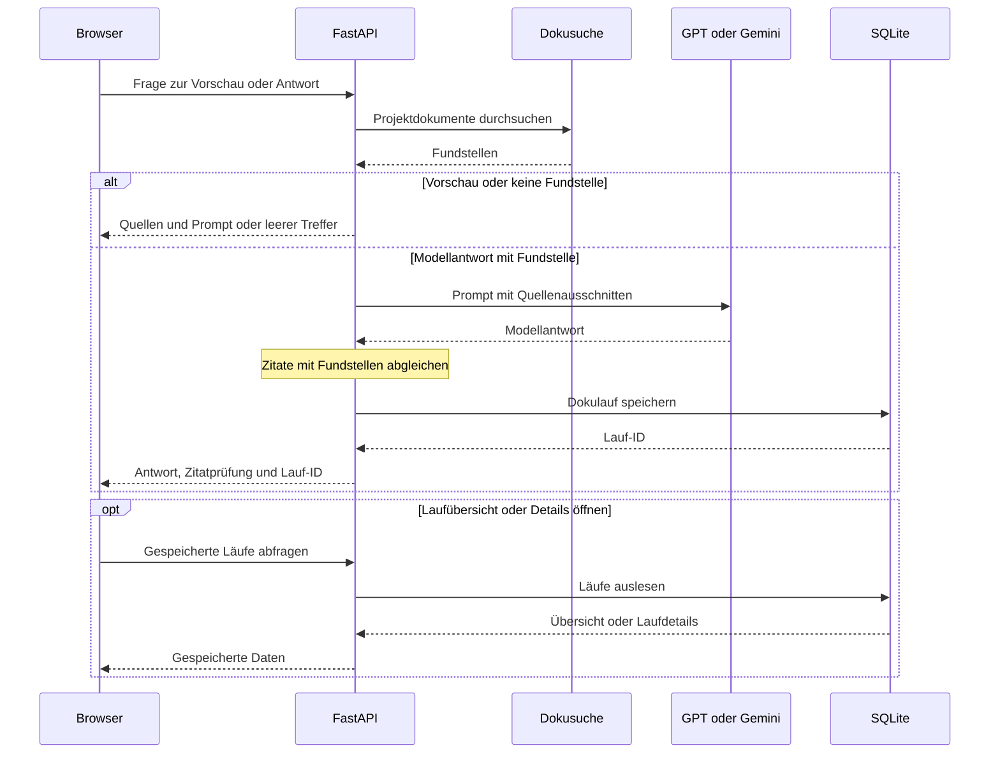

# Cosi-Lab – Lernversion

Cosi-Lab ist ein Python-Lernprojekt mit zwei Abläufen: Die **Temperaturauswertung** zählt Messwerte aus einer CSV-Datei und kann daraus einen Modellbericht erstellen. Die **Dokusuche** beantwortet Fragen anhand lokaler Markdown-Dateien und gibt die Fundstellen mit Dateipfad und Zeilenbereich an. Beide Abläufe unterstützen GPT und Gemini. Modellläufe werden lokal in SQLite gespeichert und lassen sich später ohne erneuten Modellaufruf ansehen.

Die Dokusuche funktioniert im Terminal und über eine kleine Weboberfläche. Sie nutzt **RAG** (*Retrieval-Augmented Generation*): Python sucht zuerst passende Textstellen und baut daraus einen Prompt. Erst wenn du eine Modellantwort anforderst, formuliert GPT oder Gemini daraus eine Antwort. Die Suche basiert auf Wörtern in lokalen Dateien.

Den Aufbau und die Prüfschritte halte ich im [Lernjournal](docs/journal/) fest. Der frühere Prototyp ist unter [`prototyp-2026-11-07`](https://github.com/DanielMS616/cosi-lab/tree/prototyp-2026-11-07) archiviert.

## Datenfluss

Das Diagramm zeigt beide Abläufe von der Eingabe bis zur Ausgabe. Die beiden Tabellen liegen in derselben SQLite-Datei, haben aber eigene Lauf-IDs.

```mermaid
flowchart TB
    CSV["CSV-Datei"] --> COUNT["Temperatur-CLI: Kennzahlen"]
    COUNT -->|Kennzahlen| TERM["Terminalausgabe"]
    COUNT -->|Modellbericht angefordert| TP["Temperaturprompt"]

    Q["Dokufrage im Terminal"] --> SEARCH["Lokale Dokusuche"]
    WEB["Browser"] -->|Lokal oder über SSH| API["FastAPI"]
    API -->|Vorschau oder Antwort| SEARCH
    DOC["Markdown-Dateien"] --> SEARCH
    SEARCH -->|Kein Treffer| NONE["Hinweis: keine Fundstelle"]
    SEARCH -->|Treffer| DP["Dokuprompt mit Fundstellen"]
    DP -->|Vorschau| VIEW["Fundstellen und Prompt"]

    TP --> MODEL["GPT oder Gemini"]
    DP -->|Modellantwort angefordert| MODEL
    MODEL -->|Temperaturantwort| TDB[("SQLite: model_runs")]
    MODEL -->|Dokuantwort| CITE["Fundstellen prüfen"]
    CITE --> DDB[("SQLite: doc_runs")]

    TDB --> REPORT["Temperatur-Laufansicht"]
    REPORT -->|Export bestätigt| TXT["Textdatei"]
    DDB --> HISTORY["Dokulauf in CLI oder Weboberfläche"]
```



Die **Vorschau** endet vor dem Modellaufruf. Bei einer **Dokuantwort** bleiben Frage, tatsächlich gesendeter Prompt und die damals gefundenen Ausschnitte zusammen mit der Antwort gespeichert. Die Historie liest diese Daten aus SQLite. So bleibt der Kontext eines alten Laufs nachvollziehbar, auch wenn die Markdown-Datei später geändert oder gelöscht wird.

## Schnellstart

Führe die Befehle im Projektordner aus. Falls noch keine virtuelle Umgebung existiert, lege sie einmal an:

```bash
python3 -m venv .venv
```

Verwende danach `.venv/bin/python`, damit du den Interpreter und die Pakete dieses Projekts nutzt. Die reine Temperaturauswertung und die Dokusuche im Terminal ohne Modell funktionieren ohne zusätzliche Pakete und ohne Schlüssel. Für Modellaufrufe, Weboberfläche und die vollständige Testsuite installiere die Abhängigkeiten:

```bash
.venv/bin/python -m pip install -r requirements.txt
```

Für Modellaufrufe trägst du in der lokalen `.env` im Projektordner den Schlüssel für den gewählten Anbieter ein: `OPENAI_API_KEY` für GPT oder `GEMINI_API_KEY` für Gemini. Wenn die API auf Cosi-Lab läuft, braucht **der Server dort** den Schlüssel. Die Browseroberfläche und der SSH-Tunnel brauchen keinen eigenen API-Schlüssel.

### Temperaturdaten auswerten

```bash
.venv/bin/python temperature_cli.py examples/temperature_sample.csv
.venv/bin/python temperature_cli.py examples/temperature_sample.csv \
  --threshold 65 --show-temperatures --show-prompt
```

Die Beispieldatei enthält vier Einträge: drei gültige Werte und eine fehlende Messung. Bei der Standardschwelle von 60 °C liegt ein Wert darüber; bei 65 °C sind es null, weil Gleichheit nicht als Überschreitung zählt. `--threshold` erwartet eine Ganzzahl, `--show-temperatures` zeigt die eingelesene Liste und `--show-prompt` den fertigen Schreibauftrag.

### Modellberichte und SQLite

```bash
.venv/bin/python temperature_cli.py examples/temperature_sample.csv --gpt
.venv/bin/python temperature_cli.py examples/temperature_sample.csv --gemini
```

Wähle pro Aufruf höchstens einen Anbieter. Python berechnet die Kennzahlen für beide Anbieter gleich. Ein erfolgreicher Modelllauf landet mit Modellname, CSV-Pfad, Schwelle, Prompt und Antwort in der Tabelle `model_runs` in `data/model_runs.sqlite3` und erhält eine Lauf-ID. Dazu kommen diese Metadaten:

| Feld | Bedeutung |
| --- | --- |
| `requested_at_utc` | Zeitpunkt unmittelbar vor dem Modellaufruf in UTC. Er sagt nichts darüber aus, wann die Temperatur gemessen wurde. |
| `duration_ms` | Von OpenAI im HTTP-Header `openai-processing-ms` gemeldete Verarbeitungszeit, sofern vorhanden und lesbar. Bei Gemini bleibt das Feld `NULL`. |
| `client_duration_ms` | Mit `perf_counter()` gemessene Dauer des Modellfunktionsaufrufs einschließlich SDK und Netzwerk. CSV-Auswertung, SQLite-Speicherung und Terminalausgabe liegen außerhalb der Messung. |
| `input_tokens`, `output_tokens` | Vom Anbieter gemeldete Tokenzahlen. Bei Gemini zählen getrennt gemeldete Denk-Token nicht zu `output_tokens`. |

Fehlende oder in älteren Läufen noch nicht erfasste Werte bleiben `NULL`. Die Differenz zwischen lokaler Dauer und Anbieterzeit ist keine Messung der reinen Netzwerkzeit.

Mit der `sqlite3`-Kommandozeile kannst du den jüngsten Temperatur-Modelllauf ansehen:

```bash
sqlite3 -readonly -header -column -nullvalue NULL data/model_runs.sqlite3 \
  'SELECT id, model, requested_at_utc, duration_ms, client_duration_ms,
          input_tokens, output_tokens
   FROM model_runs ORDER BY id DESC LIMIT 1;'
```

Die [drei Temperatur-Vergleichsfälle](docs/journal/2026-11-14.md#gpt-und-gemini-mit-drei-temperaturfällen-vergleichen) decken Werte genau an der Schwelle, überwiegend fehlende Werte und negative Temperaturen ab. In je einem Lauf pro Modell und Fall gaben alle sechs Antworten die fünf Sollangaben vollständig und ohne unbelegte Zusätze wieder. Daraus lässt sich keine allgemeine Rangfolge ableiten.

### Gespeicherten Temperaturlauf ansehen und exportieren

Setze statt `12` die ID ein, die beim Speichern ausgegeben wurde:

```bash
.venv/bin/python show_temperature_run.py 12
.venv/bin/python show_temperature_run.py 12 --export
```

Die Ansicht öffnet die Datenbank nur zum Lesen und zeigt den gespeicherten Prompt, die Antwort und die Metadaten. Fehlende Werte erscheinen als „nicht erfasst“. Mit `--database PFAD` kannst du eine andere SQLite-Datei wählen.

`--export` zeigt den Zielpfad und den vollständigen Bericht vor der Freigabe. Der Kopf enthält Lauf-ID, Modell, CSV-Dateiname, Schwelle und Zeitpunkt des Modellaufrufs in UTC. Darunter steht die Antwort. Nach `ja` landet genau der angezeigte Bericht als UTF-8-Text in `reports/model-run-12.txt`. Ohne Zustimmung wird nichts geschrieben; ein vorhandener Export wird nicht überschrieben. Prompt, Tokenzahlen und Laufzeiten bleiben in der Laufansicht. Siehe auch die [Anleitung zum Berichtsexport](docs/anleitung-berichtsexport.md).

### Projektdokumente durchsuchen und Fragen beantworten

In einer angegebenen Datei findet die Phrasensuche die erste Zeile mit dem zusammenhängenden Wortlaut. Mit `--question` zerlegt die Suche eine Frage in Wörter und bewertet Ausschnitte von bis zu drei Zeilen nach der Anzahl verschiedener passender Suchwörter. Bei Gleichstand bleibt der frühere Ausschnitt; zwischen Dateien entscheidet die Reihenfolge der Dateien. Die Suche ordnet `Prozessor` dem Wort `cpu` zu. Die Bestandteile des Projektnamens `Cosi-Lab` reichen allein für keinen Treffer. Im Prompt bleibt die ursprüngliche Frage erhalten.

```bash
.venv/bin/python doc_search.py docs/aufbau-fernzugriff.md "ssh im tunnel"
.venv/bin/python doc_search.py docs/aufbau-hardware.md \
  "Wie funktioniert SSH im WireGuard-Tunnel?" \
  --question --also-search docs/aufbau-fernzugriff.md --show-prompt
```

`--also-search DATEI` lässt sich wiederholen. Mit `--project-docs` entfallen die Dateipfade. Dann durchsucht das Programm die festgelegte Hardware- und Fernzugriffsdoku sowie die Anleitung zum Berichtsexport. Standardmäßig verwendet es nur den besten Ausschnitt. Mit `--multi-source` verwendet es bis zu zwei Ausschnitte aus unterschiedlichen Dateien.

```bash
.venv/bin/python doc_search.py \
  "Welche CPU ist verbaut und wie läuft SSH im WireGuard-Tunnel?" \
  --project-docs --multi-source --show-prompt
```

`--show-prompt` zeigt die Originalfrage, Fundstellen und Ausschnitte offline. Für eine Antwort kannst du denselben Aufruf um `--gpt` oder `--gemini` ergänzen. Beide Anbieter erhalten denselben für die Frage gebauten Kontext. Ohne Treffer wird kein Modell aufgerufen und kein Lauf gespeichert.

Dokuprompts verlangen kurze Antworten pro Teilfrage, eine Fundstelle direkt hinter belegten Aussagen und den Hinweis `Nicht belegt:` bei fehlenden Angaben. Die **Zitatprüfung** vergleicht erkannte Angaben wie `docs/aufbau-hardware.md:3-5` mit den Pfaden und Zeilenbereichen im Prompt. Sie erkennt unbekannte Fundstellen und meldet, wenn sie kein Zitat findet. Ob eine Fundstelle die konkrete Aussage stützt oder eine Teilfrage ausgelassen wurde, prüfst du weiterhin am Quellenausschnitt.

Die [RAG-Prüfreihe](docs/versuche/rag-pruefreihe.md) trennt Quellenauswahl und Antwortqualität. Sie enthält Fälle mit einer Quelle, zwei Quellen, einer nur teilweise belegten Frage und ohne Fundstelle. Beim Live-Vergleich belegten beide Anbieter CPU und SSH-Anmeldung und ergänzten keine Portnummer, die in den Ausschnitten fehlte.

Für Dokufragen sind bis zu **240 Ausgabetoken** vorgesehen; bei Temperaturberichten bleibt der Standard bei **120**. Im Test endete eine GPT-Antwort mit zwei Quellen bei 120 Token mit `incomplete` und dem Grund `max_output_tokens`; der Kontrolllauf mit 240 Token meldete `completed`. Ein API-Status beschreibt den technischen Zustand der Antwort, nicht ihre inhaltliche Qualität.

### Gespeicherten Dokulauf ansehen

```bash
.venv/bin/python show_doc_run.py 1
```

Ersetze `1` durch die beim Speichern ausgegebene **Dokulauf-ID**. Das Programm lädt aus SQLite die Originalfrage, den tatsächlich gesendeten Prompt, die damaligen Quellenausschnitte, die Antwort und das Ergebnis der Zitatprüfung. Dazu kommen Modell und Aufrufzeitpunkt in UTC sowie API-Status und Grund einer unvollständigen Antwort, sofern der Adapter sie liefert. Temperatur- und Dokulauf-IDs gehören zu unterschiedlichen Tabellen; dieselbe Zahl bezeichnet daher nicht zwingend denselben Vorgang.

### Weboberfläche und API lokal starten

Starte im Projektordner:

```bash
.venv/bin/python -m uvicorn doc_api:app --host 127.0.0.1 --port 8000
```

Öffne die [Weboberfläche](http://127.0.0.1:8000/) oder die [interaktive API-Dokumentation](http://127.0.0.1:8000/docs). Die Weboberfläche durchsucht die festgelegte Projektdoku. Mit **Vorschau** kannst du die gefundenen Quellen sehen und den Prompt aufklappen. Für eine Modellantwort wählst du GPT oder Gemini und kannst eine zweite Quelle zulassen. Die Laufübersicht zeigt die neuesten gespeicherten Dokuläufe; durch Anklicken oder per Lauf-ID öffnest du die Detailansicht. Die Vorschau funktioniert ohne gespeicherten Lauf und ohne API-Schlüssel.

| Methode und Pfad | Eingabe und Ergebnis |
| --- | --- |
| `GET /` | Liefert die HTML-Oberfläche. |
| `POST /doc-questions/preview` | Nimmt `question` und optional `multi_source` entgegen. Liefert Frage, Quellen und Prompt ohne Modellaufruf und ohne Speicherung. |
| `POST /doc-questions/answer` | Nutzt zusätzlich den Anbieter `gpt` oder `gemini`. Bei einem Treffer liefert der Endpunkt auch Antwort, Zitatprüfung, verfügbare API-Statusdaten und die ID des gespeicherten Laufs. |
| `GET /doc-runs?limit=10` | Listet die neuesten Läufe zuerst mit ID, Modell, Frage und UTC-Zeitpunkt. Das Limit ist auf 1 bis 100 begrenzt. |
| `GET /doc-runs/{run_id}` | Lädt die gespeicherten Details eines Laufs einschließlich Prompt, Antwort und ursprünglicher Quellenausschnitte. |

So unterscheiden sich Vorschau, Modellantwort und Abruf eines gespeicherten Laufs:



Beispiel: eine Vorschau und zwei vorhandene Läufe abrufen:

```bash
curl -i http://127.0.0.1:8000/doc-questions/preview \
  -H 'Content-Type: application/json' \
  -d '{"question":"Welche CPU hat Cosi-Lab?"}'

curl -i 'http://127.0.0.1:8000/doc-runs?limit=2'
```

Eine gültige Frage ohne Fundstelle ergibt HTTP `200` mit leerer Quellenliste und `prompt: null`. Bei einer Antwortanfrage bleibt in diesem Fall auch die Lauf-ID leer. Leere Fragen oder ungültige Eingaben werden mit `422` abgewiesen. Eine nicht vorhandene Lauf-ID ergibt `404`, wenn die Datenbank lesbar ist.

Scheitert beim Modellaufruf die Verbindung zu OpenAI, meldet die API `502`. Meldet Gemini einen vorübergehenden Ausfall mit HTTP `503`, gibt die API `503` mit einer verständlichen Meldung zurück. In diesen beiden Fehlerfällen wird kein Dokulauf gespeichert. Die Statusbehandlung ist in Offline-Tests mit simulierten Anbieterfehlern abgesichert.

### Weboberfläche auf Cosi-Lab über SSH öffnen

Der Zugriff wurde auf Ubuntu mit Commit `6bb58a6` geprüft: Die lokale Vorschau lieferte HTTP `200`, anschließend funktionierte sie im Mac-Browser über den Tunnel. Beim Zugriff von unterwegs zuerst WireGuard auf dem Mac aktivieren.

**Im ersten Mac-Terminal**: Auf Cosi-Lab anmelden und dort den Server starten. Die virtuelle Umgebung und Projektpakete müssen auf Cosi-Lab eingerichtet sein.

```bash
ssh cosi-vpn
```

```bash
cd ~/cosi-lab-lernversion
.venv/bin/python -m uvicorn doc_api:app --host 127.0.0.1 --port 8000
```

**Im zweiten, lokalen Mac-Terminal**: Den Tunnel starten und das Terminal offen lassen.

```bash
ssh -N -o ExitOnForwardFailure=yes \
  -L 127.0.0.1:8001:127.0.0.1:8000 cosi-vpn
```

Der Tunnel verbindet den lokalen Mac-Port `8001` mit dem Port `8000` auf Cosi-Lab. Öffne auf dem Mac [http://127.0.0.1:8001/](http://127.0.0.1:8001/). Uvicorn lauscht dabei weiter nur auf der lokalen Adresse von Cosi-Lab. `Ctrl+C` im zweiten Terminal beendet den Tunnel; in der ersten Sitzung beendet es Uvicorn. Die vollständige Wiederholungsanleitung steht im [Journal vom 15.11.2026](docs/journal/2026-11-15.md).

### Offline-Tests ausführen

```bash
.venv/bin/python -m unittest discover -s tests -v
```

Auf dem Mac waren am Tagesabschluss **30 Offline-Tests** erfolgreich. Sie decken unter anderem die Textsuche, Promptvorschau und Zitatprüfung, die Speicherung und Laufansicht in SQLite, den freigegebenen Berichtsexport sowie HTTP-Antworten der API ab. Echte Anbieteraufrufe werden in den Tests durch Testobjekte ersetzt. API-Schlüssel sind für die Tests nicht nötig.

## Alle versionierten Dateien

### Programm und Konfiguration

| Datei | Inhalt und Aufgabe |
| --- | --- |
| [`README.md`](README.md) | Erklärt die beiden Abläufe, ihren Datenfluss, den Schnellstart und die Aufgaben aller versionierten Dateien. |
| [`.gitignore`](.gitignore) | Hält unter anderem die lokale Umgebung, Zugangsdaten, Datenbanken und Berichtsexporte aus Git heraus. |
| [`requirements.txt`](requirements.txt) | Listet die Pakete für Modellanbieter und `.env` sowie FastAPI, Uvicorn und HTTPX für API, Weboberfläche und Tests. |
| [`temperature_cli.py`](temperature_cli.py) | Ist der Einstieg für die CSV-Temperaturauswertung. Verbindet Einlesen, Kennzahlen, Terminalausgabe und optionalen Modellbericht samt Speicherung. |
| [`temperature_csv.py`](temperature_csv.py) | Liest die Spalte `temperature_c`. Leere Felder werden zu `None`, Zahlen zu Ganzzahlen; ein ungültiger Wert wird mit Datei, Zeile und Feldinhalt gemeldet. |
| [`temperature.py`](temperature.py) | Zählt fehlende Messwerte und zählt gültige Messwerte strikt oberhalb der Schwelle. |
| [`temperature_prompt.py`](temperature_prompt.py) | Verbindet den deutschen Schreibauftrag mit den berechneten Temperaturkennzahlen. |
| [`temperature_storage.py`](temperature_storage.py) | Legt die Tabelle `model_runs` an, ergänzt fehlende Spalten bei Bedarf und speichert oder liest Temperatur-Modellläufe. |
| [`show_temperature_run.py`](show_temperature_run.py) | Zeigt einen gespeicherten Temperaturlauf per ID. Erstellt eine Exportvorschau und schreibt den Bericht nach Freigabe, ohne bestehende Dateien zu überschreiben. |
| [`model_gpt.py`](model_gpt.py) | Sendet Prompts an `gpt-4o-mini` und liefert Text sowie verfügbare Tokenzahlen, Anbieterzeit und API-Statusdaten. Das Ausgabelimit lässt sich pro Aufruf setzen. |
| [`model_gemini.py`](model_gemini.py) | Sendet Prompts an `gemini-3.5-flash-lite` und liefert Text und verfügbare Tokenzahlen. Das Ausgabelimit lässt sich ebenfalls pro Aufruf setzen. |
| [`doc_search.py`](doc_search.py) | Sucht in lokalen Dateien und wählt bis zu zwei Quellenausschnitte mit Zeilenbereichen. Bietet die Dokusuche, Vorschau und Modellabfrage im Terminal an. |
| [`doc_prompt.py`](doc_prompt.py) | Baut den Dokuprompt aus der Originalfrage und den Fundstellen. Gleicht erkannte Zitate mit den im Prompt angebotenen Pfaden und Zeilenbereichen ab. |
| [`doc_answer.py`](doc_answer.py) | Enthält den gemeinsamen Antwortablauf für CLI und API: Anbieter auswählen, Modell aufrufen, Zitate prüfen und den Dokulauf speichern. |
| [`doc_storage.py`](doc_storage.py) | Speichert Dokuläufe und ihre ursprünglichen Quellenausschnitte in `doc_runs`. Liest einzelne Läufe und die sortierte Liste der neuesten Läufe aus. |
| [`show_doc_run.py`](show_doc_run.py) | Zeigt den gespeicherten Prompt, die Quelle, die Antwort und das Ergebnis der Zitatprüfung zu einer Dokulauf-ID im Terminal. |
| [`doc_api.py`](doc_api.py) | Stellt die FastAPI-Endpunkte für Vorschau, Modellantwort, Laufübersicht und Laufdetails bereit und liefert die HTML-Oberfläche aus. |
| [`web/index.html`](web/index.html) | Enthält die Browseroberfläche mit Frageformular, Anbieterwahl, Quellenausschnitten, aufklappbarem Prompt sowie Laufübersicht und Detailansicht. |

### Tests

| Datei | Inhalt und Aufgabe |
| --- | --- |
| [`tests/test_temperature_storage.py`](tests/test_temperature_storage.py) | Prüft Speichern und Auslesen von Temperatur-Modellläufen anhand ihrer ID. Eine fehlende Datenbank darf beim Lesen nicht angelegt werden. |
| [`tests/test_temperature_report_export.py`](tests/test_temperature_report_export.py) | Prüft, dass der Dateiinhalt der Exportvorschau entspricht, eine Ablehnung keinen Ordner anlegt und ein belegtes Ziel nicht überschrieben wird. |
| [`tests/test_doc_search.py`](tests/test_doc_search.py) | Prüft die Rangfolge der Ausschnitte, die Zuordnung `Prozessor` → `CPU` und dass der Projektname allein keinen Treffer auslöst. |
| [`tests/test_doc_prompt.py`](tests/test_doc_prompt.py) | Prüft Vorschau und Mehrquellensuche, identischen Kontext für beide Modellanbieter, Zitatwarnungen und das Speichern der tatsächlich übergebenen Quellen. Prüft auch, dass ohne Treffer kein Modell aufgerufen wird. |
| [`tests/test_doc_storage.py`](tests/test_doc_storage.py) | Prüft die sortierte, begrenzte Übersicht gespeicherter Dokuläufe mit temporärer SQLite-Datei. |
| [`tests/test_show_doc_run.py`](tests/test_show_doc_run.py) | Prüft, dass die Detailansicht den damaligen Quellenausschnitt auch ohne die ursprüngliche Datei anzeigen kann. |
| [`tests/test_doc_api.py`](tests/test_doc_api.py) | Prüft Vorschau, Antwort, Laufdetails und Laufübersicht über HTTP. Simuliert unter anderem einen OpenAI-Verbindungsfehler und einen vorübergehenden Gemini-Ausfall. |

### Beispieldaten

| Datei | Inhalt und Aufgabe |
| --- | --- |
| [`examples/temperature_sample.csv`](examples/temperature_sample.csv) | Enthält die Messwerte 40, 60 und 65 °C sowie ein leeres Temperaturfeld. |
| [`examples/temperature_invalid.csv`](examples/temperature_invalid.csv) | Enthält in Zeile 3 den Wert `kaputt` statt einer Temperatur. Damit lässt sich die Fehlermeldung und der Prozesscode `1` prüfen. |
| [`examples/eval_threshold_equal.csv`](examples/eval_threshold_equal.csv) | Drei gültige Messwerte, keiner strikt über 60 °C. Prüft den Grenzfall genau auf der Schwelle. |
| [`examples/eval_mostly_missing.csv`](examples/eval_mostly_missing.csv) | Fünf Einträge, zwei gültig, drei fehlend und einer strikt über 60 °C. |
| [`examples/eval_negative_temperatures.csv`](examples/eval_negative_temperatures.csv) | Fünf Einträge, vier gültig, einer fehlend und zwei strikt über −5 °C. |

### Dokumentation und Lernjournal

| Datei | Inhalt und Aufgabe |
| --- | --- |
| [`docs/aufbau-fernzugriff.md`](docs/aufbau-fernzugriff.md) | Zeigt die Fernzugriffskette über DuckDNS, Heimrouter, WireGuard und SSH. Enthält die geprüften Zugänge über Handy-Hotspot und Bibliotheks-WLAN. |
| [`docs/aufbau-hardware.md`](docs/aufbau-hardware.md) | Zeigt den dokumentierten Hardwarestand vom 31.10.2026 mit Komponenten, Laufwerken und den damals offenen Punkten bei Kühlung und Start. |
| [`docs/anleitung-berichtsexport.md`](docs/anleitung-berichtsexport.md) | Erklärt den Export eines gespeicherten Temperaturberichts. Dient auch als durchsuchbare Quelle für Dokufragen zum Export. |
| [`docs/journal/2026-11-09.md`](docs/journal/2026-11-09.md) | Dokumentiert Zählen, CSV-Import, Fehlermeldungen, Terminaloptionen, Prompt und den ersten GPT-Aufruf. |
| [`docs/journal/2026-11-10.md`](docs/journal/2026-11-10.md) | Dokumentiert die Gemini-Anbindung, erste Modellvergleiche, SQLite-Speicherung und Anbietermetadaten. |
| [`docs/journal/2026-11-11.md`](docs/journal/2026-11-11.md) | Hält gemeinsamen Speicherblock, lokale Laufzeitmessung, Testläufe, Laufansicht und erste Offline-Tests fest. |
| [`docs/journal/2026-11-14.md`](docs/journal/2026-11-14.md) | Hält Exportfreigabe, Berichtskopf, Temperaturvergleich und den Aufbau der Dokusuche mit mehreren Quellen und Zitatprüfung fest. |
| [`docs/journal/2026-11-15.md`](docs/journal/2026-11-15.md) | Dokumentiert Gemini in der Dokusuche, SQLite-Historie, API, Weboberfläche und die auf Cosi-Lab über SSH geprüfte Vorschau. |
| [`docs/versuche/rag-pruefreihe.md`](docs/versuche/rag-pruefreihe.md) | Hält vier wiederholbare RAG-Fälle mit Soll-Ergebnissen und Beobachtungen fest. Trennt Quellenauswahl von der inhaltlichen Bewertung der Antwort. |

## Lokale Dateien und Ordner

| Pfad | Inhalt und Aufgabe |
| --- | --- |
| `.env` | Enthält die eigenen API-Schlüssel, sofern Modellaufrufe genutzt werden. Wird nicht mit Git geteilt. |
| `.venv/` | Lokale Python-Umgebung mit den Projektpaketen. Lässt sich mit `requirements.txt` neu einrichten. |
| `data/model_runs.sqlite3` | Lokale SQLite-Datenbank für `model_runs` und `doc_runs`. Beim Speichern wird die benötigte Tabelle bei Bedarf angelegt. Die Datei wird von Git ignoriert. |
| `reports/` | Enthält bestätigte Temperaturberichtsexporte als UTF-8-Textdateien, etwa `model-run-12.txt`. Der Ordner wird bei Bedarf angelegt und von Git ignoriert. |
