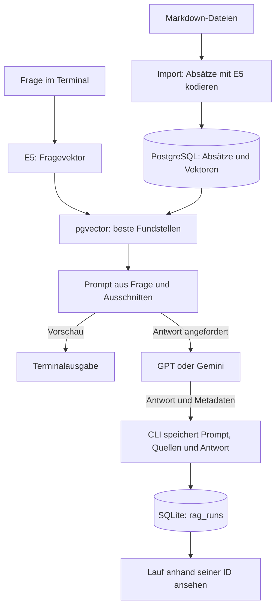

# Cosi-Lab – Lernversion

Cosi-Lab ist ein Python-Lernprojekt mit zwei Anwendungen im Terminal. Die **Temperaturauswertung** zählt Messwerte aus CSV-Dateien und kann daraus einen Modellbericht erstellen. Die **Dokusuche** beantwortet Fragen zu lokalen Markdown-Dateien mit E5, PostgreSQL und wahlweise GPT oder Gemini. Beide Anwendungen können Modellläufe lokal in SQLite speichern und später anhand ihrer ID wieder anzeigen.

**Stand: 20.11.2026 · Branch `rag-e5-neustart`.** Die aktuelle Dokusuche läuft über `rag_cli.py`. Der Neustart ist im [Lernjournal vom 19.11.2026](docs/journal/2026-11-19.md) beschrieben; dort ist auch der Wechsel des Arbeitsordners auf dem Mac und auf Cosi-Lab festgehalten. Die Doku zur früheren Wortsuche, Weboberfläche und API bleibt in den älteren [Journaleinträgen](docs/journal/) nachvollziehbar.

## Datenfluss

Die Dokusuche nutzt **RAG** (*Retrieval-Augmented Generation*): Erst werden passende Dokumentabsätze gesucht, dann kann ein Antwortmodell daraus eine belegte Antwort formulieren. Der Dokumentimport und das Stellen einer Frage sind getrennte Abläufe.



Die **Temperaturauswertung** nimmt einen anderen Weg: CSV → Kennzahlen → optionaler GPT- oder Gemini-Bericht → SQLite-Tabelle `model_runs`. Der Bericht lässt sich anschließend als Textdatei exportieren. Die Temperaturauswertung braucht kein PostgreSQL.

| Speicher | Aufgabe | Was nach einer Änderung passiert |
| --- | --- | --- |
| `examples/rag/` | Die Markdown-Originale der Dokusuche. | Änderungen werden mit `rag_import.py` in den Suchbestand übernommen. |
| PostgreSQL, `public.rag_abschnitte` | Aktueller Suchbestand: Absatztext, relativer Dateipfad, Zeilenbereich und E5-Vektor. | Ein Neuimport ersetzt den Suchbestand. Er wird aus den Originalen neu aufgebaut. |
| SQLite, `data/model_runs.sqlite3` | Laufhistorie: `model_runs` für Temperaturberichte und `rag_runs` für Dokufragen. | Ein Neuimport nach PostgreSQL ändert keine alten Läufe. Sie enthalten ihre damaligen Ausschnitte als eigene Kopie. |

## Schnellstart

Alle Befehle laufen im Projektordner. Als Python-Version ist **3.14** vorgesehen: Die hier dokumentierten Live-Läufe der RAG-CLI wurden auf dem Mac mit Python 3.14.6 geprüft, das Temperatur-Image verwendet Python 3.14.

```bash
python3 -m venv .venv
```

Verwende danach `.venv/bin/python`. Für das reine Zählen von Temperaturwerten und das Lesen vorhandener SQLite-Läufe genügt die Python-Standardbibliothek. Für die vollständige Einrichtung installierst du beide Paketlisten:

```bash
.venv/bin/python -m pip install -r requirements.txt -r requirements-rag.txt
```

`requirements.txt` enthält die beiden Anbieter-SDKs und `python-dotenv`. `requirements-rag.txt` enthält Sentence Transformers, die PostgreSQL-Anbindung sowie `python-dotenv` für den Zugriff auf die RAG-Datenbank. Für PostgreSQL brauchst du außerdem Docker mit Compose auf demselben Rechner, auf dem du importierst und suchst.

Lege die benötigten Werte in der lokalen `.env` im Projektordner ab. Die Beispielwerte ersetzt du durch deine eigenen Werte:

```dotenv
# Für PostgreSQL und die lokale Dokusuche:
RAG_POSTGRES_PASSWORD=hier_eigenes_passwort_eintragen

# Nur für Aufrufe des jeweiligen Anbieters:
# OPENAI_API_KEY=hier_eigenen_schluessel_eintragen
# GEMINI_API_KEY=hier_eigenen_schluessel_eintragen
```

Die Anbieterzeile aktivierst du, indem du das führende `#` entfernst. `--show-prompt` allein braucht keinen GPT- oder Gemini-Schlüssel. Die RAG-Vorschau benötigt dennoch E5 und PostgreSQL, um Fundstellen zu suchen. Beim ersten Laden lädt Sentence Transformers das E5-Modell herunter, sofern es noch nicht im lokalen Cache liegt. Die `.env` wird von Git ignoriert.

## Temperaturdaten auswerten

```bash
.venv/bin/python temperature_cli.py examples/temperature_sample.csv
.venv/bin/python temperature_cli.py examples/temperature_sample.csv \
  --threshold 65 --show-temperatures --show-prompt
```

Die CSV muss eine Spalte `temperature_c` enthalten. Leere Felder gelten als fehlende Werte. Das Beispiel enthält vier Einträge: drei gültige Messwerte und einen fehlenden. Bei der Standardschwelle von 60 °C liegt genau ein Wert darüber; bei 65 °C keiner, weil Gleichheit nicht als Überschreitung zählt. `--show-temperatures` zeigt die eingelesene Liste, `--show-prompt` den Schreibauftrag mit den berechneten Kennzahlen.

### Modellbericht schreiben und wieder öffnen

```bash
.venv/bin/python temperature_cli.py examples/temperature_sample.csv --gpt
.venv/bin/python temperature_cli.py examples/temperature_sample.csv --gemini
```

Pro Aufruf ist höchstens ein Anbieter erlaubt. Beide Anbieter bekommen denselben aus den Kennzahlen gebauten Prompt. Ein gespeicherter Lauf erhält eine ID in `model_runs` und enthält CSV-Pfad, Schwelle, Modell, Prompt, Antwort, Zeitstempel und die verfügbaren Token- und Laufzeitwerte.

```bash
.venv/bin/python show_temperature_run.py 1
.venv/bin/python show_temperature_run.py 1 --export
```

Setze statt `1` die ausgegebene **Temperatur-Lauf-ID** ein. Die Ansicht liest SQLite schreibgeschützt. Mit `--database PFAD` kannst du eine andere Datei angeben. Beim Export siehst du den Zielpfad und die Vorschau; erst nach `ja` wird beispielsweise `reports/model-run-1.txt` geschrieben. Ein vorhandener Bericht bleibt erhalten. Details stehen in der [Exportanleitung](docs/anleitung-berichtsexport.md).

### Temperaturauswertung in Docker

```bash
mkdir -p data reports
COSI_UID="$(id -u)" COSI_GID="$(id -g)" docker compose run --rm --build temperature
```

Der Standardbefehl im Container wertet `examples/temperature_sample.csv` aus. `data/` und `reports/` sind Verzeichnisse des Host-Rechners; dort bleiben Laufdaten und Exporte nach dem Containerlauf erhalten. `COSI_UID` und `COSI_GID` geben dem Container die Kennungen deines lokalen Benutzers, damit er in diese Verzeichnisse schreiben kann. Der Dienst ist in [compose.yaml](compose.yaml) definiert.

## Dokusuche mit E5 und PostgreSQL

### Datenbank starten und Dokumente importieren

Starte auf dem Mac bei Bedarf zuerst Docker Desktop. Auf Cosi-Lab kannst du `sudo docker …` verwenden, falls dein Benutzer Docker nicht direkt ausführen darf.

```bash
docker compose -f compose.rag.yaml up -d --wait
.venv/bin/python rag_import.py
```

[compose.rag.yaml](compose.rag.yaml) startet PostgreSQL 17 mit pgvector als Dienst `rag-db`. Die Anwendung verbindet sich auf demselben Rechner mit `127.0.0.1:5433`, der Datenbank `cosi_rag` und der Rolle `cosi_rag`. Das lokale Passwort stammt aus `RAG_POSTGRES_PASSWORD`.

Der Import liest nur die Markdown-Dateien direkt in [examples/rag/](examples/rag/). Leerzeilen trennen die Absätze; Hauptüberschriften mit `# ` werden nicht als eigener Inhalt gespeichert. E5 kodiert die Absätze mit dem Präfix `passage:`. Die drei Beispieldateien ergeben **zwölf Absätze mit je 384 Vektorwerten**. Die README und die Hardware- und Fernzugriffsdoku gehören nicht zum aktuellen Suchbestand.

```bash
docker compose -f compose.rag.yaml exec -T rag-db \
  psql -U cosi_rag -d cosi_rag -c '\d public.rag_abschnitte'

docker compose -f compose.rag.yaml exec -T rag-db \
  psql -U cosi_rag -d cosi_rag \
  -c 'SELECT dateipfad, count(*) AS absaetze, min(vector_dims(embedding)) AS dimensionen
      FROM rag_abschnitte GROUP BY dateipfad ORDER BY dateipfad;'
```

Die zweite Abfrage sollte im Beispiel vier Absätze pro Datei mit je 384 Dimensionen zeigen. Nach Änderungen am Dokumentbestand führst du `rag_import.py` erneut aus. Der Import ersetzt die vorhandenen Absätze in einer Transaktion; schlägt das Einfügen fehl, bleibt der bisherige Bestand erhalten. PostgreSQL hält seine Daten im Docker-Volume `cosi-e5-rag_rag-db-data`. Mit `docker compose -f compose.rag.yaml stop` kannst du den Dienst anhalten und mit `up -d --wait` wieder starten, ohne das Volume zu löschen.

### Fundstellen finden und Antworten anfordern

```bash
.venv/bin/python rag_cli.py \
  "Zählt genau 60 °C bei der Fräse schon als Überschreitung?" \
  --top-k 1 --show-text

.venv/bin/python rag_cli.py \
  "Wie breit soll die Halterung H-12 sein?" \
  --top-k 3 --show-prompt
```

E5 kodiert pro Frage nur den mit `query:` markierten Fragetext. pgvector sortiert die bereits gespeicherten Absatzvektoren nach Kosinusabstand. Die CLI zeigt die **Kosinusähnlichkeit** als `1 - Abstand`: Größere Werte stehen für höhere Ähnlichkeit. Sie sind keine Wahrscheinlichkeit dafür, dass ein Absatz die Frage beantwortet.

| Option | Wirkung |
| --- | --- |
| `--top-k ANZAHL` | Begrenzt die SQL-Abfrage und damit die angezeigten und für den Prompt verwendeten Absätze. Ohne Schalter gibt die Suche alle Absätze zurück. |
| `--show-text` | Zeigt zusätzlich den Originaltext des besten Treffers. |
| `--show-prompt` | Zeigt den Prompt mit Frage und ausgewählten Ausschnitten. Zusammen mit einem Anbieterschalter ist es derselbe Prompt, der gesendet wird. |
| `--gpt` / `--gemini` | Sendet den Prompt an einen Anbieter, zeigt die Antwort und speichert den Lauf. Die beiden Schalter schließen sich gegenseitig aus. |

```bash
.venv/bin/python rag_cli.py \
  "Wie breit soll die Halterung H-12 sein?" --top-k 3 --show-prompt --gpt

.venv/bin/python rag_cli.py \
  "Wie breit soll die Halterung H-12 sein?" --top-k 3 --show-prompt --gemini
```

Die Anbieter erhalten bei gleichen Suchergebnissen denselben Kontext. GPT nutzt `gpt-4o-mini`, Gemini `gemini-3.5-flash-lite`. Das Limit beträgt bei Dokufragen 240 Ausgabetoken, bei Temperaturberichten standardmäßig 120. Der RAG-Prompt fordert bei belegten Aussagen eine genaue Fundstelle und bei fehlenden Angaben `Nicht belegt:`. Ein Satz wie „Das Sollmaß steht in einer separaten Zeichnung“ belegt nur den Verweis, nicht die gesuchte Breite.

### Laufhistorie und Messwerte

Nach einer Modellantwort meldet die CLI `RAG-Lauf gespeichert: ID …`. Eine reine Suche oder Promptvorschau legt keinen Lauf an. In `rag_runs` stehen unter anderem die Frage, der tatsächlich gesendete Prompt, die Antwort, der gewählte Anbieter, das E5-Modell, `top_k` und die ausgewählten Originalausschnitte in Trefferreihenfolge.

```bash
.venv/bin/python show_rag_run.py 1

sqlite3 -readonly -header -column -nullvalue 'nicht erfasst' data/model_runs.sqlite3 \
  'SELECT id, provider, model, input_tokens, output_tokens,
          e5_load_ms, retrieval_ms, client_duration_ms, provider_duration_ms, api_status
   FROM rag_runs ORDER BY id DESC LIMIT 2;'
```

Ersetze `1` durch die ausgegebene **RAG-Lauf-ID**. Die Ansicht zeigt den damaligen Prompt, die Antwort, die Fundstellen samt Originaltext und ihre Ähnlichkeitswerte. Sie liest die SQLite-Datei schreibgeschützt; dafür müssen weder PostgreSQL noch E5 oder das Antwortmodell laufen. Mit `--database PFAD` lässt sich eine andere SQLite-Datei öffnen. RAG- und Temperatur-IDs gehören zu unterschiedlichen Tabellen; dieselbe Zahl kann daher für zwei verschiedene Läufe stehen.

| Feld | Bedeutung |
| --- | --- |
| `requested_at_utc` | UTC-Zeitpunkt unmittelbar vor dem Anbieteraufruf. |
| `e5_load_ms` | Dauer des gesamten E5-Ladevorgangs beim Start eines RAG-Aufrufs, einschließlich der Initialisierung des Tokenizers. |
| `retrieval_ms` | Dauer für den Fragevektor und die Abfrage in PostgreSQL. |
| `client_duration_ms` | Lokal gemessene Dauer des Aufrufs an GPT oder Gemini, einschließlich Client und Netzwerk. |
| `provider_duration_ms` (RAG) / `duration_ms` (Temperatur) | Vom Anbieter gemeldete Verarbeitungszeit. Der GPT-Adapter liest sie, wenn vorhanden, aus dem Header `openai-processing-ms`. Der Gemini-Adapter erfasst sie derzeit nicht. |
| `input_tokens`, `output_tokens` | Vom Anbieter gemeldete Tokenzahlen. Das konfigurierte Ausgabelimit ist ein eigener Wert. |
| `api_status`, `incomplete_reason` | Technischer Antwortstatus im RAG-Lauf, sofern der Adapter ihn liefert. `completed` bewertet nicht die inhaltliche Richtigkeit. |

Fehlende Werte bleiben in SQLite `NULL` und erscheinen in der Laufansicht als „nicht erfasst“. Die Differenz zwischen lokal gemessener Zeit und Anbieterzeit ist keine separate Messung der Netzwerkzeit.

## Prüfen und reproduzieren

```bash
.venv/bin/python -m unittest discover -s tests -v
```

Die automatisierte Offline-Suite enthält sechs Temperaturtests für SQLite-Speicherung, Laufansicht und Berichtsexport. Sie braucht keine API-Schlüssel. Die [RAG-Prüfreihe](docs/versuche/rag-pruefreihe.md) dokumentiert getrennt, welche Belege die Suche findet und ob das Antwortmodell sie richtig verwendet.

Am 20.11.2026 wurden sieben RAG-Fragen mit `--top-k 3` auf dem Mac ausgewertet, einschließlich zweier bereits gespeicherter H-12-Läufe. Für alle sechs Fragen mit erwarteten Belegen lagen die nötigen Absätze unter den ersten drei Treffern. GPT bestand sieben Fälle, Gemini sechs. Bei der Frage nach einer Bibliotheksöffnungszeit gab Gemini keine Uhrzeit an, nannte aber irrelevante Fundstellen. Ein angegebener Zeilenbereich stand so nicht im Prompt. Die Prüfreihe hält die Lauf-IDs fest; sie ist kein allgemeiner Modellvergleich. Ein automatischer Abgleich der Zitate mit den übergebenen Fundstellen ist der nächste geplante Schritt.

Für einen Lauf **auf Cosi-Lab** melde dich wie in der [Fernzugriffsdoku](docs/aufbau-fernzugriff.md) beschrieben an. Verwende dort den zum Branch gehörenden Arbeitsordner (dokumentiert als `~/cosi-lab-e5-neustart`). Richte die virtuelle Umgebung und `.env` auf diesem Rechner ein, starte den lokalen PostgreSQL-Dienst und importiere die Beispiele wie oben. Die SQLite-Historie liegt auf dem Rechner, auf dem die CLI ausgeführt wurde. Eine auf dem Mac erzeugte Lauf-ID ist daher auf Cosi-Lab nicht automatisch vorhanden.

## Dateiübersicht

### Programm und Konfiguration

| Datei | Aufgabe |
| --- | --- |
| [`rag_cli.py`](rag_cli.py) | Dokufragen stellen, E5-Fragevektor berechnen, Fundstellen und Prompt anzeigen, optional eine Modellantwort anfordern und speichern. |
| [`rag_import.py`](rag_import.py) | Markdown-Absätze kodieren und den PostgreSQL-Suchbestand neu befüllen. |
| [`rag_db.py`](rag_db.py) | PostgreSQL-Verbindung und sortierte pgvector-Abfrage. |
| [`rag_run_storage.py`](rag_run_storage.py) | RAG-Läufe und ihre Quellenausschnitte in SQLite speichern und schreibgeschützt lesen. |
| [`show_rag_run.py`](show_rag_run.py) | Details zu einer gespeicherten RAG-Lauf-ID anzeigen. |
| [`temperature_cli.py`](temperature_cli.py) | CSV-Auswertung, Kennzahlen und optionalen Modellbericht verbinden. |
| [`temperature_csv.py`](temperature_csv.py) | Die Spalte `temperature_c` auslesen und ungültige Werte melden. |
| [`temperature.py`](temperature.py) | Fehlende Werte und gültige Messwerte strikt über der Schwelle zählen. |
| [`temperature_prompt.py`](temperature_prompt.py) | Den Prompt für den Temperaturbericht bauen. |
| [`temperature_storage.py`](temperature_storage.py) | Temperatur-Modellläufe in SQLite speichern und lesen. |
| [`show_temperature_run.py`](show_temperature_run.py) | Temperaturlauf anzeigen und den Bericht nach Bestätigung exportieren. |
| [`model_gpt.py`](model_gpt.py), [`model_gemini.py`](model_gemini.py) | Gemeinsame Anbieteradapter für die beiden Anwendungen. |
| [`requirements.txt`](requirements.txt), [`requirements-rag.txt`](requirements-rag.txt) | Abhängigkeiten für Modellaufrufe und die lokale RAG-Suche. |
| [`Dockerfile`](Dockerfile), [`compose.yaml`](compose.yaml) | Python-Image und Dienst für die Temperaturauswertung. |
| [`compose.rag.yaml`](compose.rag.yaml) | Lokaler PostgreSQL-Dienst mit pgvector, Healthcheck und Datenvolume. |
| [`.gitignore`](.gitignore), [`.dockerignore`](.dockerignore) | Schließen unter anderem lokale Zugangsdaten und Laufdateien aus Git bzw. dem Docker-Build-Kontext aus. |

### Beispieldaten, Tests und Dokumentation

| Datei oder Ordner | Aufgabe |
| --- | --- |
| [`examples/temperature_sample.csv`](examples/temperature_sample.csv), [`examples/temperature_invalid.csv`](examples/temperature_invalid.csv) | Einstieg mit gültigen und fehlenden Messwerten sowie ein Beispiel für die Meldung bei einem ungültigen Wert. |
| [`examples/eval_threshold_equal.csv`](examples/eval_threshold_equal.csv), [`examples/eval_mostly_missing.csv`](examples/eval_mostly_missing.csv), [`examples/eval_negative_temperatures.csv`](examples/eval_negative_temperatures.csv) | Vergleichsfälle für Schwellenwert, fehlende Werte und negative Temperaturen. |
| [Fräse F-07](examples/rag/fraese-f07.md), [Maßprüfung H-12](examples/rag/masspruefung-h12.md), [Verstärkerrack „Nachtflug“](examples/rag/nachtflug-rack.md) | Der derzeitige Dokumentbestand der RAG-Suche. |
| [`tests/test_temperature_storage.py`](tests/test_temperature_storage.py), [`tests/test_temperature_report_export.py`](tests/test_temperature_report_export.py) | Automatisierte Temperaturtests für SQLite-Läufe und Export. |
| [`docs/versuche/rag-pruefreihe.md`](docs/versuche/rag-pruefreihe.md) | Sieben Fragen samt Sollantworten, erwarteten Fundstellen, Ergebnissen und Lauf-IDs. |
| [`docs/anleitung-berichtsexport.md`](docs/anleitung-berichtsexport.md) | Kurzanleitung zum Export eines Temperaturberichts. |
| [Hardwareaufbau](docs/aufbau-hardware.md), [Fernzugriff](docs/aufbau-fernzugriff.md) | Dokumentation zum Rechner und zu den geprüften Verbindungswegen. |
| [`docs/journal/`](docs/journal/) | Lernjournal mit Arbeitsschritten, Entscheidungen und früheren Versuchen. |

`.venv/`, `.env`, die SQLite-Datei unter `data/` und bestätigte Exporte unter `reports/` sind lokal. Der PostgreSQL-Suchbestand liegt im Docker-Volume. Ein Git-Checkout enthält die Programme und die Originaldokumente; Suchbestand und Laufhistorie werden separat aufgebaut bzw. gespeichert.
